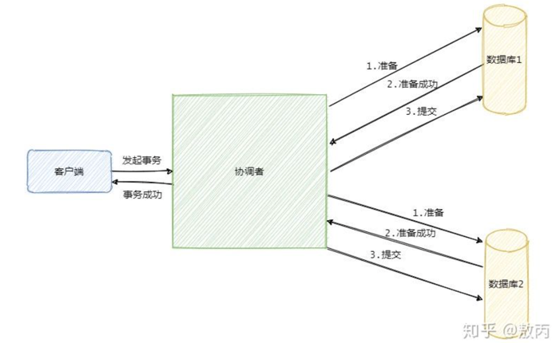
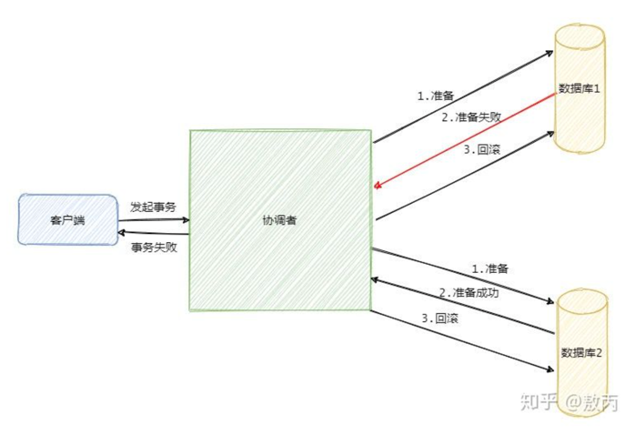
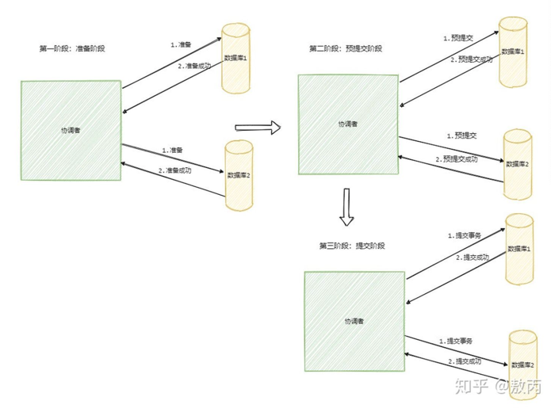
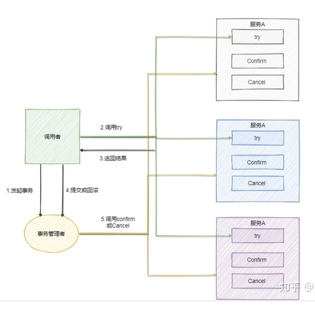

# 分布式基础

分布式系统由部署在不同节点上的多个服务协作完成业务。网络延迟、节点故障和消息重复等问题，使跨服务的数据一致性不能只依赖单机数据库事务。

## CAP 理论

分布式系统中，发生网络分区时无法同时保证一致性（C）和可用性（A）；分区容错性（P）通常必须满足，因此需要在 C 和 A 之间取舍。

- Consistency（一致性）：同一时刻从任一节点读取到的数据一致。强一致性要求所有节点立即一致；弱一致性允许短暂不一致；最终一致性允许经过一段时间后达到一致。
- Availability（可用性）：每次请求都能在有限时间内获得响应，响应允许不是最新数据。
- Partition Tolerance（分区容错性）：网络分区或部分节点不可用时，系统仍能继续提供服务。

## BASE 理论

BASE 是在 CAP 约束下对可用性与一致性的权衡，核心思想是在不能保证强一致性时，通过业务设计达到最终一致性。

- Basically Available（基本可用）
- Soft State（软状态）
- Eventually Consistent（最终一致性）

## 分布式事务概览

分布式事务是由多个服务或资源管理器中的本地事务共同组成的一次业务操作。例如“创建订单、扣减库存、扣减余额”分别由不同服务完成，但业务上要么整体成功，要么按规则恢复到可接受状态。

| 方案 | 一致性目标 | 典型实现 | 适用场景 |
| --- | --- | --- | --- |
| 2PC / XA | 强一致性 | MySQL XA、Atomikos、Narayana、Seata XA | 并发可控、事务短、强一致要求高 |
| 3PC | 尝试降低阻塞 | 理论协议，工程实践较少 | 通常不作为首选 |
| TCC | 业务层强一致或接近强一致 | Seata TCC、ByteTCC、Hmily | 资金、库存等核心业务 |
| Saga | 最终一致性 | Seata Saga、状态机编排 | 长事务、跨多个服务流程 |
| 事务消息 | 最终一致性 | RocketMQ 事务消息 | 下单后异步扣库存、发券、积分 |
| 本地消息表 | 最终一致性 | 本地事务 + 定时投递器 | 不依赖 MQ 事务能力的异步流程 |
| 最大努力通知 | 尽力达到最终一致 | 支付结果通知、回调重试 | 通知类且可由接收方查询兜底的场景 |

> 2PC、3PC、TCC、Saga 是协调多个操作的事务协议或模式；事务消息、本地消息表和最大努力通知是实现最终一致性的可靠消息方案。它们不都等价于“强一致的分布式事务”。

## 1. 2PC：二阶段提交

2PC（Two-Phase Commit）由事务协调者统一协调多个参与者，分为准备和提交两个阶段。




```text
阶段一：Prepare（准备 / 投票）
协调者要求所有参与者执行本地事务并锁定资源，但暂不提交。

阶段二：Commit 或 Rollback（提交或回滚）
全部参与者都返回成功 -> 协调者发送 Commit。
任一参与者失败或超时 -> 协调者发送 Rollback。
```

优点是能够提供较强的一致性；缺点是资源会被长时间锁定，协调者或网络故障还可能导致参与者阻塞。因此不适合高并发、长事务场景。

常见实现：JDBC XA、MySQL XA、Atomikos、Narayana，以及 Seata XA 模式。

## 2. 3PC：三阶段提交

3PC（Three-Phase Commit）在 2PC 的基础上增加了 PreCommit（预提交）阶段：CanCommit、PreCommit、DoCommit。它试图通过超时机制减少阻塞，但实现复杂，且在网络分区等极端情况下仍无法彻底解决一致性问题，生产项目中较少直接采用。



## 3. TCC：Try、Confirm、Cancel

TCC 是业务层的两阶段事务。每个参与服务都要显式提供三个接口：

```text
Try：检查业务条件并预留资源，例如冻结余额、冻结库存。
Confirm：确认执行，真正扣减冻结的资源。
Cancel：撤销预留，释放冻结的资源。
```



以转账为例：

```text
Try：A 账户冻结 100 元；B 账户预增加 100 元。
Confirm：A 正式扣款；B 正式入账。
Cancel：A 解冻 100 元；B 取消预增加。
```

接口示意：

```java
public interface AccountTccService {

    /**
     * 尝试冻结账户余额。
     *
     * @param accountId 账户编号
     * @param amount 冻结金额
     * @return 是否冻结成功
     */
    boolean tryFreeze(String accountId, BigDecimal amount);

    /**
     * 确认扣减已冻结的余额。
     *
     * @param accountId 账户编号
     * @param amount 扣减金额
     * @return 是否确认成功
     */
    boolean confirm(String accountId, BigDecimal amount);

    /**
     * 取消冻结并恢复可用余额。
     *
     * @param accountId 账户编号
     * @param amount 取消金额
     * @return 是否取消成功
     */
    boolean cancel(String accountId, BigDecimal amount);
}
```

TCC 的优点是资源锁定和业务规则都可控；代价是业务侵入较强。实现时必须处理幂等、空回滚和悬挂：

- 幂等：Confirm、Cancel 可能被重复调用，重复执行结果必须一致。
- 空回滚：Try 因超时未执行，但 Cancel 已到达，Cancel 不能错误地创建或恢复资源。
- 悬挂：Cancel 已执行后，延迟到达的 Try 必须被拒绝，不能再次冻结资源。

常见实现：Seata TCC、ByteTCC、Hmily。

## 4. Saga：本地事务 + 补偿事务

Saga 将一个长事务拆成多个可独立提交的本地事务；每一步都需要定义相应的补偿动作。它不持有全局锁，适合长流程，但通常只保证最终一致性。

```text
T1 创建订单       -> C1 取消订单
T2 扣减库存       -> C2 恢复库存
T3 扣减余额       -> C3 退款或恢复余额
T4 创建物流单     -> C4 取消物流单
```

如果 T3 失败，则按逆序执行 C2、C1。补偿并不是数据库回滚，而是一笔新的业务操作，因此要考虑补偿失败的重试、人工介入和对账。

Saga 常见两种组织方式：

- 编排式：由 Saga 协调器或状态机决定下一步和补偿顺序，流程清晰。
- 协同式：服务通过事件驱动后续服务，耦合较低，但整体流程更难追踪。

常见实现：Seata Saga、工作流状态机或自研编排器。

## 5. RocketMQ 事务消息

RocketMQ 事务消息通过“半消息”解决“本地数据库提交成功但消息未发送”或“消息先被消费但本地事务失败”的问题。

```text
1. 生产者发送半消息，Broker 暂不投递给消费者。
2. 生产者执行本地数据库事务。
3. 本地事务成功则提交消息；失败则回滚消息。
4. 若 Broker 未收到最终状态，会回查生产者的本地事务状态。
5. 只有已提交的消息才会投递给消费者。
```

发送事务消息的核心调用：

```java
rocketMQTemplate.sendMessageInTransaction("tx-topic", message, null);
```

本地事务与回查逻辑示意：

```java
@Override
public RocketMQLocalTransactionState executeLocalTransaction(Message message, Object argument) {
    try {
        // 在此执行本地订单、事务记录等数据库操作。
        return RocketMQLocalTransactionState.COMMIT;
    } catch (Exception exception) {
        return RocketMQLocalTransactionState.ROLLBACK;
    }
}

@Override
public RocketMQLocalTransactionState checkLocalTransaction(Message message) {
    // 必须根据事务编号从数据库查询最终事务状态。
    return RocketMQLocalTransactionState.COMMIT;
}
```

事务消息只保证“本地事务”和“消息发送”的原子性，不保证消费者业务一定只执行一次。消费者仍应基于订单号、业务流水号等唯一键实现幂等，并配置重试、死信和告警。

## 6. 本地消息表

本地消息表不依赖 MQ 的事务机制。业务数据与待发送消息记录在同一个本地数据库事务中提交，后台投递器可靠地把未发送消息推送给 MQ 或下游服务。

```text
本地事务：创建订单 + 插入消息表记录。
投递器：扫描待发送消息 -> 投递成功后更新为已发送。
消费者：按业务唯一键去重 -> 执行业务操作。
兜底：投递失败重试，超过阈值进入死信或人工补偿。
```

消息表字段通常包括：消息编号、业务唯一键、主题、消息内容、发送状态、重试次数、下次重试时间、创建时间和更新时间。

该方案实现简单、可审计性强，但需要自行维护投递器、重试和消息表清理。

## 7. 最大努力通知

最大努力通知由通知方持续重试发送消息，在规定次数或期限内尽力保证接收方收到。超过阈值后通常进入人工处理；接收方也可以主动查询通知方的最终状态作为兜底。

典型场景：支付结果回调、物流状态通知、第三方平台通知。它适用于允许短暂不一致且具备查询补偿能力的场景，不适合余额扣减等必须严格控制的核心写操作。

## 方案选型

```text
要求同步强一致、事务很短、并发可控：XA / 2PC。
资金或库存等核心操作，能接受业务改造：TCC。
跨服务长流程，能够定义补偿动作：Saga。
订单创建后异步扣库存、发券、积分：RocketMQ 事务消息或本地消息表。
支付、物流等结果通知：最大努力通知。
```

多数互联网业务优先选择“本地事务 + 可靠消息 + 消费幂等 + 重试 + 死信 + 对账补偿”，以较高可用性换取最终一致性；只有确实需要时才使用全局强一致事务。

## 幂等性

幂等性指对同一操作发起一次或多次请求，最终结果一致，不会因为重复请求产生额外副作用。分布式事务中的超时重试、消息至少投递一次和回调重复都会导致重复执行，因此幂等性是必备能力。

- 查询操作：在数据不变时多次查询结果相同，天然幂等。
- 删除操作：删除同一资源多次，目标不存在时也按成功处理，通常可以设计为幂等。
- 设置操作：例如“订单状态设置为已支付”，通常是幂等的。
- 增减操作：例如“余额减 100”，天然不幂等，必须使用业务流水号、版本号或状态机控制。
- Token 机制：服务端生成一次性 Token，请求时携带；成功处理后删除 Token，重复提交因 Token 不存在而被拒绝。
- 唯一键去重：为请求号、订单号或消息编号建立唯一索引，确保同一业务只成功处理一次。

> 分布式场景中通常只能做到“至少一次投递 + 幂等消费”，而不是依赖消息系统提供绝对的“恰好一次处理”。
